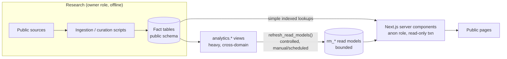

# Architecture

## Overview



## Database

- PostgreSQL 17. Development and replay use an embedded PG17 on the VPS. Production will be a separate Supabase project.
- Migrations live in `database/migrations/NNN_name.sql` and are applied by `scripts/db/lib/migrations.mjs`:
  - one transaction per file;
  - each file's checksum is recorded in `bai_meta.schema_migrations`;
  - an applied migration is **frozen**, so a changed checksum aborts the run and a change means a new migration.
- Schemas:
  - `public`: fact tables, public views and read models.
  - `analytics`: heavy views. Never granted to public roles.
  - `bai_meta`: migration bookkeeping.
  - `ingest`: research staging (batches, staged records, identity resolution). Never granted to public roles.

| Migration | Content |
|---|---|
| 001_core_identity | extensions, platform roles, helpers, `sources`, players, aliases, external ids |
| 002_organizations | 30 franchises, season-ranged name history, aliases (seeded, convergent) |
| 003_sources_provenance | provenance registry (`provenance_fact_tables`), `source_observations`, conflict view |
| 004_research_coverage | coverage states and assessments, research tasks, quality flags |
| 005_expectations | shared ranking lists/entries, evaluations, tool grades |
| 006_international | markets, date-bounded signing periods, signings, org period context, trainers, academies |
| 007_draft | schools, drafts, rounds/phases, selections, slot values, pools, signings, shared acquisition layer, expectation links |
| 008_outcomes | outcome audits, MLB debuts, WAR observations, outcome status view |
| 009_development | affiliates by season, assignments, promotion/demotion events |
| 010_transactions_value | transactions, trade packages/assets, organization value attributions |
| 011_public_foundation | read models, `refresh_read_models()`, RLS and grants for the whole public schema |
| 012_source_authority_reconciliation | source authority and metadata (retrieved date, effective range, archived URL), rules eras, conflict rules, `fact_resolutions`, `v_open_fact_conflicts`, `apply_public_boundary()` |
| 013_ingestion | `ingest` schema: import batches, staged sources and records, `ingest.resolve_identity()` |
| 014_research_queues_coverage | research queue types and `v_research_queue`, `analytics.research_coverage_cells`, `rm_research_coverage`, `rm_research_queue_summary`, refresh v2 |
| 015_reference_calendars | sourced 2015–2026 drafts and 2014-15 → 2026 signing periods, rules eras, observations, recorded calendar resolutions (generated by `scripts/research/generate-calendar-seed.mjs`) |
| 016_web_reader_role | `bai_web`: NOINHERIT login role for the web read pool, member of `anon` only; password set out of band |
| 017_platform_default_privileges | removes Supabase's pre-2026 default grants to anon/authenticated/service_role in public and the sequence/service_role grants they produced (no-op locally) |
| 018_btree_gist_extensions_schema | moves btree_gist from public to the `extensions` schema |
| 020_outcome_import_channel | `OUTCOMES` ingest channel and `OUTCOME_AUDIT` staged record type |
| 021_research_decision_history | append-only decision history; reviewers bound to their database logins (`bai_reviewer`, `bai_automation`); human-only SECURITY DEFINER functions; certification gate (closed) and fingerprinted certification checks; guarded resolutions and certifications; revocation triggers on every canonical table ([decision-history.md](decision-history.md)) |
| 022_acquisition_dispositions | `acquisition_dispositions` (how each acquisition ended, separate from the player's career), consistency guard, legacy backfill, `analytics.player_acquisitions` / `acquisition_tenures` |
| 023_organizational_value | `TRADES` channel (`TRADE` record) and value views: season WAR, coverage, acquisition value (signed acquisitions only, own tenure), trade returns, class value |
| 019_research_backfill | private `research` schema (channels, classes, stage machine, jobs, batches, leads, import reviews, certifications, program waves, class metrics/status, the queue), franchise history names and `resolve_organization()`, `outcome_audit_details`, `analytics.player_outcome_profile` / `acquisition_economics` / `class_economics`, public `rm_research_certification` |

Hosted (Supabase) databases are migrated with `supabase db push` from the same files (`supabase/migrations` is a symlink to `database/migrations`); the BAI runner then verifies the pushed history statement by statement and records checksums in `bai_meta`. See [supabase.md](supabase.md).

## Public boundary (RLS)

- Every table in `public` has RLS enabled, and every view is `security_invoker`.
- Public tables get `SELECT` for `anon`/`authenticated` plus a `public_read` select policy. No role other than the owner has write privileges or write policies.
- Internal objects get no grants and no policy:
  - registered in `public.internal_objects`;
  - includes `research_tasks`, `quality_flags`, `read_model_refreshes`, `v_source_conflicts`, `fact_resolutions`, `conflict_rules`, `v_open_fact_conflicts` and `v_research_queue`.
  - Tables created after 011 pass through `public.apply_public_boundary()`, which applies the same rules.
- Defense in depth: even if a Supabase-style blanket grant is applied, RLS still returns no internal rows and blocks writes. A test covers this.
- Public roles cannot execute any function in `public` (including the refresh) and have no access to `analytics`.
- The app's `publicQuery()` (`lib/db.ts`) runs every page query inside `BEGIN READ ONLY`, with `SET LOCAL ROLE anon` and a statement timeout. The production RLS boundary is therefore exercised in local development too.

## Serving model (learned from DISI v1.0.0 / 045a)

DISI's v1.0.0 overview recomputed a deep analytical graph per request, which stalled a small instance under four concurrent readers. BAI's rule from day one:

1. **Simple indexed facts** (a player, a pick list, an organization's acquisitions) are queried directly, with explicit `LIMIT`s.
2. **Heavy summaries** follow a fixed path:
   - they are defined in `analytics.*`;
   - they are materialized by `refresh_read_models()` into bounded `rm_*` tables:
     - one overview row;
     - one row per organization;
     - one row per coverage assessment;
     - one row per (draft or signing period) × organization for the coverage dashboard (720 rows for the 2015–2026 calendar);
     - one row per research queue (counts only);
   - the UI reads only the `rm_*` tables.
3. The refresh:
   - is run by the owner (`npm run refresh:read-models`), never by a request;
   - is serialized by an EXCLUSIVE lock and replaces rows with DELETE + INSERT in a single transaction, so readers see the old or the new generation, never a mix;
   - validates before commit (organization row count, outcome states partition acquired players);
   - converges (an unchanged database yields identical rows; only `generation_id`/`refreshed_at` change).
4. Large nested analytical graphs are never exposed publicly.

## App

- Next.js App Router with server components. Every page is `force-dynamic`, so the build never touches a database.
- Pages degrade to a notice when the database is not configured.
- Navigation: Overview, International, Draft, Organizations, Players, Compare, Research.
- `dev` and `start` bind to `127.0.0.1` by default.

## Local security

- **Localhost only.** PostgreSQL (`npm run db:server`, port 54329) and Next (`npm run dev` / `npm run start`) listen on 127.0.0.1 only. No development port is exposed on the VPS's public interface, and the firewall and services are unchanged.
- **Browser testing over an SSH tunnel:**

  ```bash
  ssh -N -L 3000:127.0.0.1:3000 <user>@<vps-host>     # then open http://localhost:3000 locally
  ssh -N -L 3417:127.0.0.1:3417 <user>@<vps-host>     # if the app was started with PORT=3417
  ```

- **No remote databases by default.** Owner scripts refuse a non-local database host unless `BAI_ALLOW_REMOTE_DB=1` is set deliberately. The research CLI never prints connection strings.
- **No hosted database yet.** No Supabase project exists for BAI, and DISI's is never used.

## Testing

- `tests/db/*`: each file boots a disposable PostgreSQL 17 (embedded binaries, random port, temp dir) and replays every migration from 001 into fresh databases.
- `tests/app/*`:
  - unit tests for formatting and navigation;
  - an integration test that runs every page query through `publicQuery()` against migrated and fixture-loaded PG17.
- TypeScript modules are loaded in tests through a small hook (`tests/support/ts-hooks.mjs`), because the distro Node build lacks built-in type stripping.
