# Data model

Every entity uses a stable internal `bigint` id. Players also carry a stable `player_key` uuid. Organizations carry a frozen `franchise_key`, which does not change when a club renames.

**Names are never identity.** `players.full_name` is not unique and is not the preferred join. Ingestion resolves players through `player_external_ids` (`resolve_player(system, id)`). Name/alias lookups (`player_name_candidates`) return every candidate for a human to disambiguate.

## ERD

```mermaid
erDiagram
  sources ||--o{ source_observations : "cites"
  provenance_fact_tables ||--o{ source_observations : "subject table"

  players ||--o{ player_aliases : has
  players ||--o{ player_external_ids : has
  organizations ||--o{ organization_names : "named (by season)"
  organizations ||--o{ organization_aliases : has

  %% International
  international_signing_periods ||--o{ international_signings : "contains (date range)"
  markets ||--o{ international_signings : in
  players ||--o{ international_signings : signs
  organizations ||--o{ international_signings : acquires
  organizations ||--o{ organization_signing_period_context : "pool/restriction"
  international_signing_periods ||--o{ organization_signing_period_context : for
  trainers ||--o{ player_trainer_relationships : ""
  academies ||--o{ player_academy_relationships : ""
  players ||--o{ player_trainer_relationships : ""
  players ||--o{ player_academy_relationships : ""

  %% Draft
  drafts ||--o{ draft_rounds : "structure"
  drafts ||--o{ draft_selections : ""
  draft_rounds ||--o{ draft_selections : ""
  players ||--o{ draft_selections : "selected (0..n drafts)"
  organizations ||--o{ draft_selections : selects
  schools ||--o{ draft_selections : from
  schools ||--o{ school_aliases : has
  draft_selections ||--o| draft_signings : "signing outcome"
  drafts ||--o{ slot_values : ""
  drafts ||--o{ organization_draft_pools : ""

  %% Expectations (shared)
  ranking_lists ||--o{ ranking_entries : ""
  players ||--o{ ranking_entries : ranked
  players ||--o{ evaluations : evaluated
  evaluations ||--o{ evaluation_grades : ""
  international_signings ||--o{ acquisition_expectation_links : ""
  draft_selections ||--o{ acquisition_expectation_links : ""
  ranking_entries ||--o{ acquisition_expectation_links : ""
  evaluations ||--o{ acquisition_expectation_links : ""

  %% Outcomes & development
  players ||--o{ outcome_audits : audited
  players ||--o| mlb_debuts : debuts
  organizations ||--o{ mlb_debuts : "debut org"
  players ||--o{ war_observations : ""
  affiliates ||--o{ affiliate_seasons : ""
  organizations ||--o{ affiliate_seasons : ""
  players ||--o{ player_assignments : ""
  players ||--o{ development_events : ""

  %% Transactions & value
  transactions ||--o{ trade_packages : ""
  trade_packages ||--o{ trade_package_assets : ""
  players ||--o{ trade_package_assets : ""
  organizations ||--o{ organization_value_attributions : credited
  war_observations ||--o{ organization_value_attributions : "basis (once per org)"
  trade_packages ||--o{ organization_value_attributions : ""

  coverage_assessments }o--o| organizations : scope
```

Every fact table above, apart from identity and lookup tables, also references `sources` through a NOT NULL `source_id`. Those edges are omitted from the diagram for readability.

## Domains

### Identity and organizations (001, 002)

- `players`:
  - bio fields, each with a precision; `name_normalized` is generated (ASCII-folded) and indexed but not unique.
  - `player_aliases` is unique per player per normalized alias, with a typed alias.
  - `player_external_ids`: an external id maps to one player (`unique(id_system, external_id)`), and a player has one id per system.
- `organizations`:
  - 30 seeded franchises with `franchise_key`, current slug and name, league/division, and MLBAM team id.
  - `organization_names` is season-ranged with a GiST exclusion constraint (one name per franchise per season). Seeded renames that touch the window are Indians → Guardians (2022), Oakland Athletics → Athletics (2025), and Los Angeles Angels of Anaheim → Los Angeles Angels (2016).
  - `organization_name_in_season(org, season)`.

### Sources and provenance (001, 003)

- `sources`: `publicly_accessible` is constrained to true, which enforces public data only. `source_type` includes `TEST_FIXTURE`, which a research database must never contain.
- `provenance_fact_tables` registers every researched-fact table. A test asserts that each one has a NOT NULL `source_id` FK.
- `source_observations` holds what a given source said about a given field of a given row:
  - status is ACTIVE, SUPERSEDED or RETRACTED;
  - one active observation per source per field;
  - conflicting values coexist and surface in `v_source_conflicts` (internal).

### Coverage and research operations (004)

- `coverage_assessments(domain, scope_key, organization_id?)` has state constraints:

  | State | Requirement |
  |---|---|
  | COMPLETE_CENSUS | expected known, tracked = expected, source required |
  | SUBSTANTIALLY_COMPLETE | expected known, gaps listed, source required |
  | RANKED_SAMPLE | sample basis required |

  In every state `tracked ≤ expected` when expected is known.
- `coverage_supports_population_rate(state)` is the only gate for rate denominators. It is true for COMPLETE_CENSUS and SUBSTANTIALLY_COMPLETE only.
- `research_tasks` and `quality_flags` are internal.

### Expectations (005, 007)

- Shared across channels (`domain` = INTERNATIONAL | DRAFT):
  - `ranking_lists` (publication rank / board / mock / org list, with `published_date`) and `ranking_entries`;
  - `evaluations`, with FV only when published, and `evaluation_grades` (20–80 present/future per skill);
  - `summary_note` is at most 400 characters and must be a paraphrase, never copied prose.
- The views `international_rankings`, `draft_rankings`, `international_evaluations` and `draft_evaluations` filter by domain.
- `acquisition_expectation_links` connects an acquisition to its expectation evidence. A trigger requires the same player, the same channel, and `published_date < acquisition_cutoff_date`.
- `v_acquisition_time_expectations` lists every structured expectation published before the cutoff.
- The cutoff is the exact signing or selection date, or the period start when the international signing date is not exact (conservative).

### International (006)

- `international_signing_periods`: an explicit `[start_date, end_date]`, with no overlaps (exclusion constraint). `international_period_for_date(d)` returns the period containing a date.
- `international_signings`:
  - `pathway` is INTERNATIONAL_AMATEUR, POSTING_SYSTEM, INTERNATIONAL_PROFESSIONAL or OTHER;
  - the date carries a precision; a DAY-precision date must fall inside the assigned period (trigger);
  - cost components `signing_bonus_usd`, `posting_fee_usd`, `transfer_fee_usd` and `other_cost_usd` are separate, where NULL means unknown and 0 means known zero;
  - generated `known_total_cost_usd` sums known components only (NULL if none are known);
  - generated `cost_completeness` is ALL_COMPONENTS_KNOWN, PARTIAL or UNKNOWN.
- `organization_signing_period_context` holds pool and restriction per club and period.
- `trainers`, `academies`, `player_trainer_relationships` and `player_academy_relationships` all require a source and a verification level (VERIFIED/REPORTED). `at_signing` is nullable, meaning not established.

### Draft (007)

- PLAYER, DRAFT, DRAFT SELECTION and DRAFT SIGNING are separate tables.
- `drafts`:
  - `draft_kind` is JUNE_AMATEUR, JANUARY_REGULAR, JANUARY_SECONDARY, JUNE_SECONDARY or OTHER;
  - start/end dates and an optional total round count are recorded per draft;
  - `draft_rounds` stores the published round code, order and phase (REGULAR, COMPENSATION, COMPETITIVE_BALANCE_A/B, SUPPLEMENTAL, PRIZE, OTHER).
- `draft_selections`:
  - unique per (draft, player), so repeat selections happen across drafts;
  - unique per (draft, overall pick) and per (round, round pick);
  - the round must belong to the same draft (composite FK);
  - carries the school and the school type at selection.
- `draft_signings`:
  - at most one per selection, either SIGNED or DID_NOT_SIGN;
  - a selection without a row is **UNKNOWN** (not researched), never "unsigned";
  - DID_NOT_SIGN carries no bonus or date, and a SIGNED bonus may still be unknown.
- `slot_values` and `organization_draft_pools` are stored per draft.
- `v_draft_picks` is the flattened pick list with slot value and derived signing status.
- `v_acquisitions` is the shared acquisition layer, one row per international signing or draft selection.

### Outcomes (008)

- `outcome_audits` states:

  | State | Meaning |
  |---|---|
  | NOT_AUDITED | default for players with no audit row |
  | AUDITED_REACHED_MLB | audited; reached MLB |
  | AUDITED_NO_MLB | audited; did not reach MLB |
  | ACTIVE_TOO_RECENT | audited; too recent to judge |
  | OUT_OF_SCOPE | outside the research scope |
  | UNKNOWN | outcome could not be established |

  The two AUDITED states and ACTIVE_TOO_RECENT need `observation_through_season` and a source.
- Deferred constraint triggers keep audits consistent with `mlb_debuts`: REACHED requires a debut by the through season, and NO_MLB forbids one.
- `war_observations`:
  - system is BREF (bWAR/rWAR), FANGRAPHS or OTHER;
  - scope is CAREER, SEASON or ORGANIZATION_TENURE;
  - `war_value` is NOT NULL, so missing WAR is simply absent.
- `v_player_outcome_status` gives the current audit (or NOT_AUDITED), the debut, and the latest career bWAR (or NULL).
- `analytics.acquisition_outcome_summary` reports audited reached / audited no-MLB / not audited / other, separately.

### Development (009)

- `affiliates` plus `affiliate_seasons`, because parent club and level change by season.
- `player_assignments` are stints: org, affiliate, level, season, start/end, precision, and `games` (NULL means not recorded).
- `development_events`:
  - types are ASSIGNED, PROMOTED, DEMOTED, INJURED_LIST, ACTIVATED, RELEASED and OTHER;
  - a promotion must move up and a demotion down (level rank);
  - `reason` requires its own `reason_source_id`, because BAI never infers reasons.
- `v_player_development_chronology`.

### Transactions and value (010)

- `transactions` → `trade_packages` (one per direction) → `trade_package_assets` (PLAYER, PTBNL, CASH, DRAFT_PICK, INTERNATIONAL_POOL_SPACE, OTHER).
- `organization_value_attributions`:
  - value classes are DIRECT_ACQUIRING_ORGANIZATION, TRADE_RETURN, PLAYER_ATTRIBUTABLE_DOWNSTREAM, PACKAGE_ATTRIBUTABLE, OBSERVABLE_NOT_ATTRIBUTABLE and VALUE_LEFT_ORGANIZATION;
  - each row is based on one `war_observation`;
  - **`unique(organization_id, war_observation_id)`**, so an observation is credited to an organization once, in one class, which prevents double counting;
  - per-class required references are enforced by CHECKs.
- `analytics.organization_realized_value` reports realized value (excluding VALUE_LEFT_ORGANIZATION) next to departed value. The two are never summed.

### Public foundation (011)

- `rm_overview`, `rm_organization_summary` and `rm_coverage_summary`, plus `read_model_refreshes`.
- `refresh_read_models()`.
- RLS and grants are applied to the whole `public` schema.

### Source authority, rules eras and reconciliation (012)

- `sources` gains:
  - `authority_level`: OFFICIAL, PRIMARY_PUBLIC, REPUTABLE_SECONDARY, AGGREGATOR, ARCHIVE or OTHER;
  - `retrieved_date` (renamed from `accessed_date`);
  - `reference`, `effective_from` / `effective_to` and `archived_url`.

  Every non-fixture source must carry a URL or a reference.
- `source_authority_rank()` orders authority for the explicit `PREFER_HIGHER_AUTHORITY` rule only.
- `rules_eras` holds CBA eras, kept separate for draft and international because their effective dates differ. `drafts.rules_era_id` and `international_signing_periods.rules_era_id` point to them, and periods also gain a `timing_note`.
- `provenance_fact_tables.primary_source_required`: `players` is registered as observable without a single primary citation, because identity is evidenced field by field.
- `conflict_rules(subject_table, field_name)` declares one of REQUIRE_OPERATOR, PREFER_HIGHER_AUTHORITY, PREFER_MORE_PRECISE_DATE or KEEP_ALL. A field without a row requires an operator.
- `fact_resolutions` records each decision: the chosen observation, every observation considered, the rule, who decided and why. There is one per field, and it is internal.
- `v_open_fact_conflicts` lists disagreeing active observations that no resolution covers. It is internal.
- `apply_public_boundary()` applies 011's RLS and grant policy to any table created later.

### Ingestion staging (013, schema `ingest`, never public)

- `import_batches`: unique `batch_key`, unique `file_sha256`, channel, status (STAGED → VALIDATED or VALIDATION_FAILED → APPLIED, or ABANDONED), coverage claims, last report.
- `staged_sources` and `staged_records`: the raw payload, validation status and errors, identity state, candidates and matched player, conflict status and details, review state (UNREVIEWED, AUTO_ACCEPTED, NEEDS_REVIEW, APPROVED, REJECTED), proposed and applied action, and a canonical reference.
- `resolve_identity(jsonb)` returns one of EXACT_EXTERNAL_ID, EXACT_COMPOSITE, PROBABLE_MATCH, AMBIGUOUS, NO_MATCH or CONFLICT, plus the candidates. See [identity-resolution.md](identity-resolution.md).

### Research queues and coverage dashboard (014)

- `research_queue_types` declares ten queues with fixed priorities.
- `v_research_queue` (internal) is one row per open item:
  - IDENTITY_AMBIGUOUS, SOURCE_CONFLICT, DRAFT_SIGNING_STATUS_UNKNOWN, MISSING_SIGNING_DATE, CLASS_INCOMPLETE;
  - MISSING_COST, MISSING_SIGNING_MARKET, SCHOOL_UNRESOLVED;
  - OUTCOME_NOT_AUDITED, MISSING_EXPECTATION.
- `analytics.research_coverage_cells` is one cell per (Rule 4 draft or signing period) × active organization. Each cell holds:
  - tracked records and expected count;
  - audited outcomes;
  - known-cost numerator and basis;
  - coverage state and the rate gate;
  - last research date.
- `rm_research_coverage` and `rm_research_queue_summary` are the refreshed, public, bounded read models behind `/research`.

### Reference calendars (015)

- **Drafts:** the twelve Rule 4 drafts (2015–2026). `draft_kind` stays `JUNE_AMATEUR` even for the July drafts from 2021; it names the Rule 4 draft, not the month.
- **Signing periods:** the twelve international periods 2014-15 → 2026, with keys `2014-15` … `2020-21`, then `2022` … `2026`.
- **Evidence:** 78 calendar sources (prefixed `cal:`) and their observations.
- **Recorded disagreements:** two calendar disagreements are resolved in `fact_resolutions`.
